<!-- Perfil temático de fã. -->


<a href="https://github.com/pjz3650?tab=repositories"></a><a href="https://githubcard.com/pjz3650"></a><a href="https://github-rpg-card.github-rpg-card.workers.dev/?username=pjz3650&amp;theme=cyberpunk"></a>
<a href="https://github.com/pjz3650#js-contribution-activity"></a>
<a href="https://github.com/pjz3650#js-contribution-activity"></a>

<a href="https://github.com/pjz3650/pokedex-strategy-hub"></a><a href="https://github.com/pjz3650/codex-mcp-skill-transfer"></a>
<a href="https://github.com/pjz3650/analise-reverberacao-sala-sp"></a><a href="https://github.com/pjz3650/strudel-based-studio"></a>

<a href="https://github.com/pjz3650/pokedex-strategy-hub#readme"></a>
<a href="https://github.com/pjz3650/codex-mcp-skill-transfer#readme"></a>
<a href="https://github.com/pjz3650/analise-reverberacao-sala-sp#readme"></a>


